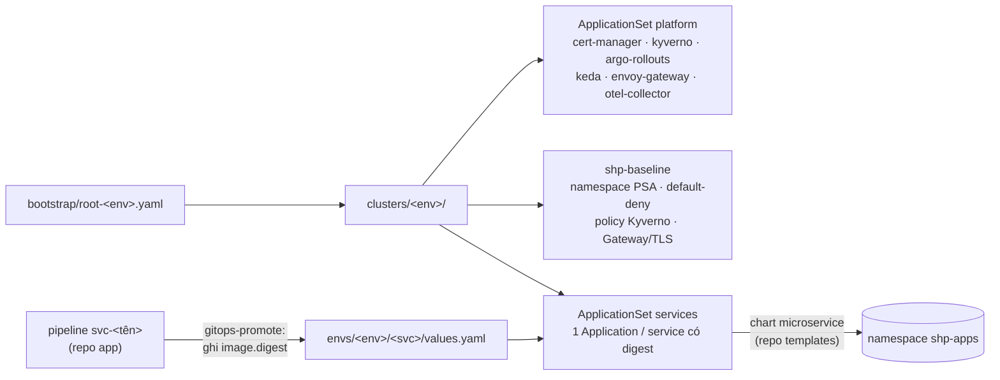

# shp-gitops

Trạng thái mong muốn của các cụm Kubernetes (`uat`, `prod`) cho Smart Hospital Platform. **Argo CD** đọc repo này và tự đồng bộ.
Không ai `kubectl apply` hay `helm install` tay lên cụm. Mọi thay đổi đi qua commit/PR vào `main`.
Quyết định kiến trúc: ADR-0009, ADR-0010, ADR-0011 ở repo ứng dụng.



## Cấu trúc
| Đường dẫn | Nội dung | Ai sửa |
|---|---|---|
| `bootstrap/argocd-values.yaml`, `bootstrap/root-<env>.yaml` | Cài Argo CD và root Application (app-of-apps), áp dụng một lần bởi ENV-01 | SA |
| `clusters/<env>/projects.yaml` | AppProject `platform` (add-on) và `shp-apps` (service chỉ được vào namespace `shp-apps`, không tạo tài nguyên cấp cụm) | SA |
| `clusters/<env>/platform.yaml` | ApplicationSet add-on (ghim version chart) + Application `shp-baseline` | SA |
| `clusters/<env>/services.yaml` | ApplicationSet service: mỗi `envs/<env>/<svc>/values.yaml` **có digest** → một Application | SA |
| `platform/addons/<tên>/values.yaml` | Values của add-on; ghi đè theo môi trường ở `envs/<env>/addons/<tên>.yaml` | SA |
| `platform/charts/shp-baseline/` | Namespace PSA restricted, NetworkPolicy default-deny, 4 policy Kyverno (chỉ ACR, chữ ký cosign, cấm `:latest`, bắt buộc resources/probe), Gateway + Let's Encrypt | SA |
| `envs/services-common.yaml`, `envs/<env>/services.yaml` | Values chung cho mọi service (OTLP, OIDC, số replica) | SA |
| `envs/<env>/<svc>/values.yaml` | Values riêng; **`image.digest` do pipeline ghi, không sửa tay** | pipeline / SA |

`clusters/uat` và `clusters/prod` giống nhau, chỉ khác tên môi trường. `tools/validate.sh` kiểm điều này.

## Luồng đưa code lên môi trường
1. Merge vào `main` của repo app. Pipeline `svc-<tên>` build image, quét, ký cosign, đẩy lên ACR, rồi chạy `gitops-promote`.
2. **uat:** bot commit digest mới vào `envs/uat/<svc>/values.yaml`. **prod:** bot mở PR, SA review rồi merge (môi trường `deploy-prod` cần duyệt).
3. Argo CD thấy thay đổi và deploy. Kyverno chặn image không đến từ ACR hoặc không có chữ ký của pipeline.
4. **Rollback:** `git revert` commit promote rồi merge. Argo CD đưa về digest cũ, thường dưới 5 phút.

## Trước khi dựng một môi trường (ENV-01)
Điền các ô đang để trống. Không có ô nào là secret, giá trị lấy từ output Terraform và cấu hình Entra ID:
- `envs/<env>/platform.yaml`: `acrLoginServer`, `gateway.hostname`, `gateway.acmeEmail`.
- `envs/<env>/services.yaml`: `OIDC_AUTHORITY`, `OIDC_AUDIENCE`.
- `envs/<env>/<svc>/values.yaml`: `image.repository` = `<acrLoginServer>/<svc>`.

Kiểm bằng `tools/validate.sh --strict` (lỗi nếu còn ô trống). Secret, gồm credential đọc repo của Argo CD và connection string
Application Insights, do ENV-01 tạo trực tiếp trong cụm từ Key Vault. **Không bao giờ commit secret vào repo này.**

## Kiểm tra cục bộ
```bash
TEMPLATES_DIR=../shp-platform-templates tools/validate.sh   # cần helm 3.18, kubeconform 0.7, python3 + PyYAML
```
Script kiểm YAML, so `clusters/uat` với `prod`, render chart nền và 8 service × 2 môi trường, rồi chạy kubeconform kèm schema CRD
(Argo CD, Kyverno, Gateway API, cert-manager, Argo Rollouts).

## Chưa có (backlog SA)
- **ENV-01**: workflow `env-provision` (repo infra) cài Argo CD bằng `bootstrap/`, tạo Secret từ Key Vault, chờ healthy, smoke test.
- **Kết nối DB/bus cho service trên cloud**: chờ module IaC dữ liệu (IAC-09..16). Khi có thì thêm biến không nhạy cảm vào `envs/<env>/<svc>/values.yaml`,
  còn mật khẩu đi qua `keyVault.objects` + Workload Identity (`workloadIdentity.clientId`).
- **CIT-09**: ghim chart `microservice` theo tag thay vì nhánh.
- **Nhánh `main`**: Argo CD và bot promote dùng `main`. Repo này cần nhánh mặc định `main`; tạo bằng PR từ nhánh làm việc.
