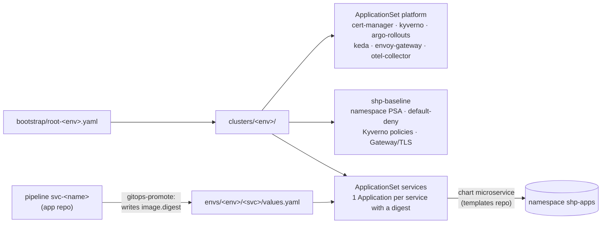

# shp-gitops

Desired state of the Kubernetes clusters (`uat`, `prod`) for the Smart Hospital Platform. **Argo CD** reads this repo and syncs it on its own.
Nobody runs `kubectl apply` or `helm install` by hand against a cluster. Every change goes through a commit or PR into `main`.
Architecture decisions: ADR-0009, ADR-0010, ADR-0011 in the application repo.



## Layout
| Path | Content | Who edits it |
|---|---|---|
| `bootstrap/argocd-values.yaml`, `bootstrap/root-<env>.yaml` | Installs Argo CD and the root Application (app-of-apps); applied once by ENV-01 | SA |
| `clusters/<env>/projects.yaml` | AppProjects `platform` (add-ons) and `shp-apps` (services may only deploy into namespace `shp-apps` and cannot create cluster-scoped resources) | SA |
| `clusters/<env>/platform.yaml` | ApplicationSet for add-ons (pinned chart version) + the `shp-baseline` Application | SA |
| `clusters/<env>/services.yaml` | Service ApplicationSet: every `envs/<env>/<svc>/values.yaml` that **has a digest** becomes one Application | SA |
| `platform/addons/<name>/values.yaml` | Add-on values; per-environment overrides live in `envs/<env>/addons/<name>.yaml` | SA |
| `platform/charts/shp-baseline/` | Namespace at PSA restricted, default-deny NetworkPolicy, 4 Kyverno policies (ACR only, cosign signature, no `:latest`, resources/probes required), Gateway + Let's Encrypt | SA |
| `envs/services-common.yaml`, `envs/<env>/services.yaml` | Values shared by every service (OTLP, OIDC, replica count) | SA |
| `envs/<env>/<svc>/values.yaml` | Per-service values; **`image.digest` is written by the pipeline, never edited by hand** | pipeline / SA |

`clusters/uat` and `clusters/prod` are the same apart from the environment name. `tools/validate.sh` checks that.

## How code reaches an environment
1. Merge into `main` of the app repo. The `svc-<name>` pipeline builds the image, scans it, signs it with cosign, pushes it to ACR, then runs `gitops-promote`.
2. **uat:** the bot commits the new digest to `envs/uat/<svc>/values.yaml`. **prod:** the bot opens a PR, the SA reviews and merges it (the `deploy-prod` environment needs approval).
3. Argo CD sees the change and deploys. Kyverno blocks images that did not come from ACR or carry no pipeline signature.
4. **Rollback:** `git revert` the promote commit and merge. Argo CD goes back to the previous digest, usually in under 5 minutes.

## Before you provision an environment (ENV-01)
Fill in the fields that are still empty. None of them is a secret; the values come from Terraform outputs and the Keycloak realm (ADR-0017; `OIDC_AUTHORITY` = `https://<gateway.hostname>/idp/realms/shp`, `OIDC_AUDIENCE` = `shp-api`):
- `envs/<env>/platform.yaml`: `acrLoginServer`, `gateway.hostname`, `gateway.acmeEmail`.
- `envs/<env>/services.yaml`: `OIDC_AUTHORITY`, `OIDC_AUDIENCE`.
- `envs/<env>/<svc>/values.yaml`: `image.repository` = `<acrLoginServer>/<svc>`.

Check with `tools/validate.sh --strict` (it fails while a field is empty). Secrets, including Argo CD's repo read credential and the
Application Insights connection string, are created by ENV-01 directly inside the cluster from Key Vault. **Never commit a secret to this repo.**

## Local checks
```bash
TEMPLATES_DIR=../shp-platform-templates tools/validate.sh   # needs helm 3.18, kubeconform 0.7, python3 + PyYAML
```
The script checks the YAML, compares `clusters/uat` with `prod`, renders the base chart and 8 services × 2 environments, then runs kubeconform with the CRD
schemas (Argo CD, Kyverno, Gateway API, cert-manager, Argo Rollouts).

## Not built yet (SA backlog)
- **ENV-01**: the `env-provision` workflow (infra repo) installs Argo CD from `bootstrap/`, creates the Secrets from Key Vault, waits for healthy, runs a smoke test.
- **Database and message bus for services in the cloud**: waiting on the data IaC modules (IAC-09..16). Once they exist, add the non-sensitive variables to `envs/<env>/<svc>/values.yaml`,
  and let passwords go through `keyVault.objects` + Workload Identity (`workloadIdentity.clientId`).
- **CIT-09**: pin the `microservice` chart by tag instead of by branch.
- **`main` branch**: Argo CD and the promote bot use `main`. This repo needs `main` as its default branch; create it with a PR from the working branch.
