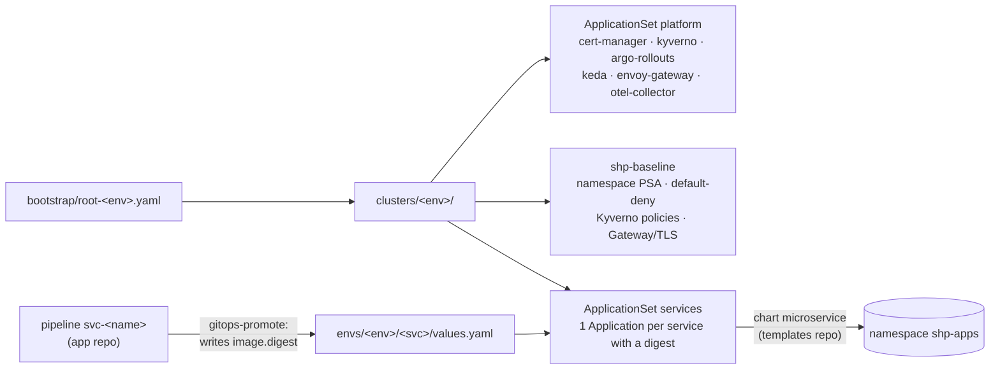

# shp-gitops

Desired state of the Kubernetes clusters (`uat`, `prod`) for the Smart Hospital Platform. **Argo CD** reads this repo and syncs it on its own.
Nobody runs `kubectl apply` or `helm install` by hand against a cluster. Every change goes through a commit or PR into `main`.
Architecture decisions: ADR-0009, ADR-0010, ADR-0011 in the application repo.



## Layout
| Path | Content | Who edits it |
|---|---|---|
| `bootstrap/argocd-values.yaml`, `bootstrap/root-<env>.yaml` | Installs Argo CD and the root Application (app-of-apps); applied once by ENV-01 | SA |
| `clusters/<env>/projects.yaml` | AppProjects `platform` (add-ons) and `shp-apps` (services may only deploy into namespace `shp-apps` and cannot create cluster-scoped resources) | SA |
| `clusters/<env>/platform.yaml` | ApplicationSet for add-ons (pinned chart version) + the `shp-baseline` Application | SA |
| `clusters/<env>/services.yaml` | Service ApplicationSet: every `envs/<env>/<svc>/values.yaml` that **has a digest** becomes one Application | SA |
| `platform/addons/<name>/values.yaml` | Add-on values; per-environment overrides live in `envs/<env>/addons/<name>.yaml` | SA |
| `platform/charts/shp-keycloak/` | Keycloak (ADR-0017, IAM-01): namespace `shp-iam` (PSA restricted, default-deny NetworkPolicy), 2 replicas in prod, realm `shp` imported from `files/realm-shp.json`, `/idp` HTTPRoute + ReferenceGrant. Values: `envs/<env>/keycloak.yaml` | SA |
| `platform/charts/shp-baseline/` | Namespace at PSA restricted, default-deny NetworkPolicy, 4 Kyverno policies (ACR only, cosign signature, no `:latest`, resources/probes required), Gateway + Let's Encrypt, and the `ClientTrafficPolicy` that gives Envoy the real client IP | SA |
| `platform/charts/mlflow/`, `envs/<env>/addons/mlflow.yaml` | MLflow tracking + model registry in namespace `shp-deps` (GOP-10): PostgreSQL backend store, artifacts on the Blob `mlops` container, both through Workload Identity (no password or key); NetworkPolicy limits callers to `shp-apps` | SA |
| `platform/charts/ml-retrain/`, `envs/<env>/addons/ml-retrain.yaml` | CronJob (`concurrencyPolicy: Forbid`, no retries) that runs `python -m shp_ml.retrain` in `shp-apps` (MLO-04); renders nothing until the training image digest is set | SA |
| `envs/services-common.yaml`, `envs/<env>/services.yaml` | Values shared by every service (OTLP, OIDC, replica count) | SA |
| `envs/<env>/<svc>/values.yaml` | Per-service values; **`image.digest` is written by the pipeline, never edited by hand** | pipeline / SA |
| `tools/validate.sh`, `tools/identity/` | Local/CI validation; `apply-realm.sh` reconciles a running realm, `fetch-breached-password-list.sh` downloads the pinned password blacklist | SA |
| `docs/runbooks/` | Operational procedures, starting with [the realm runbook](docs/runbooks/keycloak-realm.md) | SA |

`clusters/uat` and `clusters/prod` are the same apart from the environment name. `tools/validate.sh` checks that.

## How code reaches an environment
1. Merge into `main` of the app repo. The `svc-<name>` pipeline builds the image, scans it, signs it with cosign, pushes it to ACR, then runs `gitops-promote`.
2. **uat:** the bot commits the new digest to `envs/uat/<svc>/values.yaml`. **prod:** the bot opens a PR, the SA reviews and merges it (the `deploy-prod` environment needs approval).
3. Argo CD sees the change and deploys. Kyverno blocks images that did not come from ACR or carry no pipeline signature.
4. **Rollback:** `git revert` the promote commit and merge. Argo CD goes back to the previous digest, usually in under 5 minutes.

## Before you provision an environment (ENV-01)
Fill in the fields that are still empty. None of them is a secret; the values come from Terraform outputs and the Keycloak realm (ADR-0017; `OIDC_AUTHORITY` = `https://<gateway.hostname>/idp/realms/shp`, `OIDC_AUDIENCE` = `shp-api`):
- `envs/<env>/platform.yaml`: `acrLoginServer`, `gateway.hostname`, `gateway.acmeEmail`.
- `envs/<env>/services.yaml`: `OIDC_AUTHORITY`, `OIDC_AUDIENCE`.
- `envs/<env>/addons/mlflow.yaml` (GOP-10): `image.repository` and `image.digest` (the MLflow image with the PostgreSQL and Azure drivers, recipe in `platform/charts/mlflow/values.yaml`), `workloadIdentity.clientId`, `database.host`, `database.user` (Entra principal of the mlflow identity), `artifacts.storageAccount`.
- `envs/<env>/<svc>/values.yaml`: `image.repository` = `<acrLoginServer>/<svc>`.
- `envs/<env>/keycloak.yaml` (IAM-01): `hostname` (= `gateway.hostname`), `database.host`, `workloadIdentity.clientId`, `keyVault.name`, `keyVault.tenantId`, `kubernetesClientAuth.issuer` (the AKS OIDC issuer URL); all but the last are in `terraform output keycloak_values` (IAC-16). The Key Vault secrets `keycloak-db-password` and `keycloak-admin-password` are created by Terraform and mounted by the Secrets Store CSI driver; they never appear here.
- `envs/<env>/keycloak.yaml` before the realm serves real users: `passwordBlacklist.file` = the fetched curated list and `passwordBlacklist.requireCuratedList: true` (see [the realm runbook](docs/runbooks/keycloak-realm.md) §3); until then self-registration stays off.
- `envs/<env>/platform.yaml`: `gateway.xffNumTrustedHops` = the number of L7 proxies in front of the Gateway's load balancer (0 today; 1 once Azure Front Door/WAF is there), so the per-client `/idp` rate limit sees the real client address.

Check with `tools/validate.sh --strict` (it fails while a field is empty). Secrets, including Argo CD's repo read credential and the
Application Insights connection string, are created by ENV-01 directly inside the cluster from Key Vault. **Never commit a secret to this repo.**

## Keycloak realm (IAM-01, IAM-06)
`platform/charts/shp-keycloak/files/realm-shp.json` is a **copy** of `identity/realm/dist/realm-shp-prod.json` in the application repo, which `tools/identity/realm.py` builds from the same source as the local realm (so local and cluster cannot drift). Do not edit it here: change `identity/realm/` in the application repo, run the generator, and copy the file. `tools/validate.sh` always checks the copy for development content (users, `shp-test`, `localhost`, credentials); with `APP_DIR=<checkout of smart-hospital-platform>` it also compares the copy with the generated file, and CI sets `APP_DIR` from the `APP_DEPLOY_KEY` deploy key. It also fails when the rendered `/idp` route would expose the admin console, the master realm, client registration, health or metrics, when the real-client-IP policy or the route rate limit is missing, and when a realm allows self-registration with a starter password blacklist.

Keycloak imports a realm only when it does not exist yet (`--import-realm`), so a realm change does **not** reach a running environment by itself. Use [the realm runbook](docs/runbooks/keycloak-realm.md): `tools/identity/apply-realm.sh` reconciles a running realm (`--check` reports drift without changing anything), and `tools/identity/fetch-breached-password-list.sh` provides the pinned breached-password list that a realm serving real users needs.

## Local checks
```bash
TEMPLATES_DIR=../shp-platform-templates tools/validate.sh   # needs helm 3.18, kubeconform 0.7, python3 + PyYAML
APP_DIR=../smart-hospital-platform TEMPLATES_DIR=../shp-platform-templates tools/validate.sh   # also checks realm drift
```
The script checks the YAML, compares `clusters/uat` with `prod`, renders the base chart, Keycloak and 8 services × 2 environments, then runs kubeconform with the CRD
schemas (Argo CD, Kyverno, Gateway API, Envoy Gateway, cert-manager, Argo Rollouts). The tooling for `tools/identity/apply-realm.sh`
(its `--exec` mode) is exercised against a throwaway Keycloak container, never against a shared cluster.

## Not built yet (SA backlog)
- **ENV-01**: the `env-provision` workflow (infra repo) installs Argo CD from `bootstrap/`, creates the Secrets from Key Vault, waits for healthy, runs a smoke test.
- **Database and message bus for services in the cloud**: waiting on the data IaC modules (IAC-09..16). Once they exist, add the non-sensitive variables to `envs/<env>/<svc>/values.yaml`,
  and let passwords go through `keyVault.objects` + Workload Identity (`workloadIdentity.clientId`).
- **CIT-09**: pin the `microservice` chart by tag instead of by branch.
- **`main` branch**: Argo CD and the promote bot use `main`. This repo needs `main` as its default branch; create it with a PR from the working branch.
